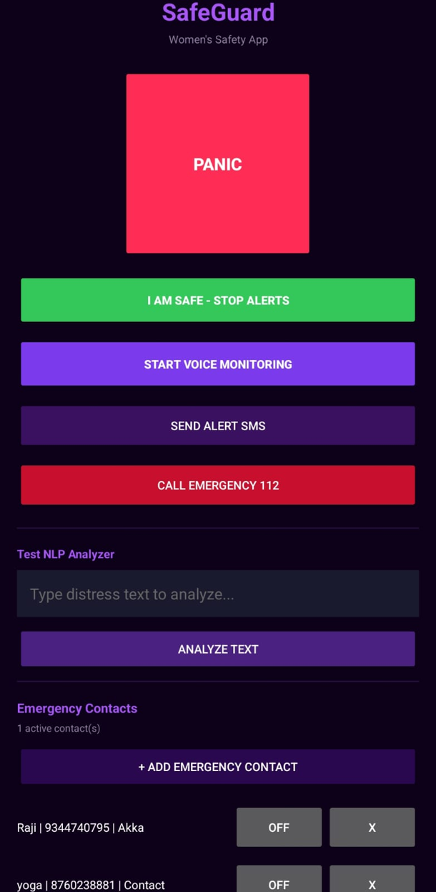
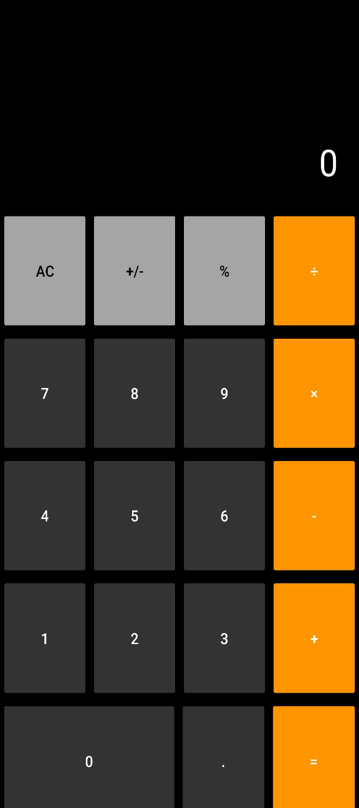
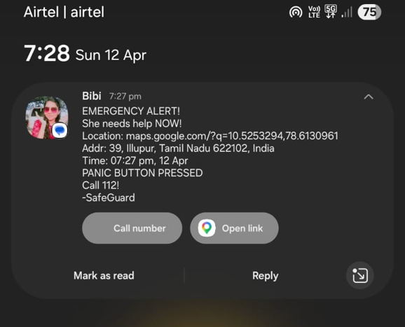
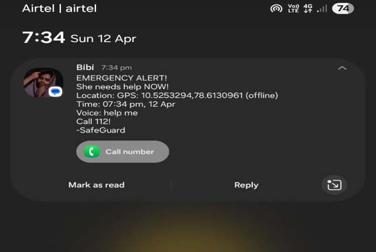
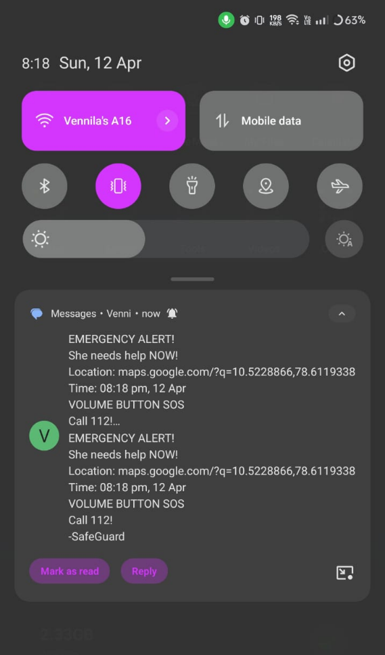

# SafeGuard --- Offline Women's Safety Android App

SafeGuard is an Android safety application designed to help a user send
an emergency SMS to trusted contacts through multiple SOS triggers. It
combines rule-based distress phrase detection, acoustic voice analysis,
and on-device speech recognition to support safety workflows in
low-connectivity situations.

> **Important:** SafeGuard is an academic project and should not be
> treated as a replacement for emergency services. Detection can fail,
> SMS delivery depends on a working SIM/mobile network, and location
> accuracy depends on the device and available signals. Test responsibly
> with consenting contacts before relying on it.

## Features

-   **Five SOS triggers:** panic button, voice-triggered distress
    phrases, shake detection, Volume Down button sequence, and a
    configurable secret word.
-   **English and Tamil distress phrases:** rule-based phrase matching
    includes English phrases and Tamil/Tamil-transliterated terms.
-   **Offline speech recognition:** Vosk can process speech on-device
    when a compatible model is installed.
-   **Voice emotion heuristics:** acoustic features such as pitch,
    energy, speech rate, and zero-crossing rate are used to estimate
    states such as panic, fear, anger, crying, or normal speech.
-   **Emergency SMS:** sends an alert to configured emergency contacts
    using Android's native SMS APIs and the device's SIM.
-   **Location in alerts:** includes GPS coordinates or a map link;
    address lookup may be available when internet access is available.
-   **Stealth calculator screen:** a calculator-style interface can
    conceal access to the main app behind a PIN.
-   **Alarm and safety controls:** configurable alert behaviour,
    vibration/flashlight options, repeat alerts, and an "I Am Safe"
    action to stop alerts.
-   **NLP testing screen:** allows distress text to be tested against
    the phrase classifier.
-   **Background monitoring and reboot handling:** included in the
    project design; behaviour may vary with Android version and
    manufacturer battery/security restrictions.

## Screenshots
## Screenshots

### Main Safety Screen


### Calculator Stealth Mode


### Emergency SMS Alerts




  -------------------------------------------------------------------------------------------------


## Technology Stack

-   **Language:** Kotlin
-   **Platform:** Android (minimum API 24 / Android 7.0, as specified by
    the project)
-   **IDE:** Android Studio
-   **Speech recognition:** Vosk Android SDK (`0.3.47` listed in the
    project report)
-   **Location:** Google Play Services Location (`21.3.0` listed in the
    project report)
-   **Asynchronous work:** Kotlin Coroutines (`1.8.0` listed in the
    project report)
-   **JSON:** Gson (`2.10.1` listed in the project report)
-   **SMS:** Android `SmsManager`
-   **Sensors:** Android `SensorManager` / accelerometer
-   **Audio analysis:** `AudioRecord` and custom acoustic-feature
    calculations

Dependency versions above are taken from the project report. Check the
Gradle files in the repository for the exact versions currently
configured.

## How It Works

SafeGuard is organised around four logical layers:

1.  **Trigger layer** --- listens for configured voice phrases, detects
    a shake pattern, handles the Volume Down sequence, exposes the panic
    button, and checks the secret word.
2.  **AI processing layer** --- classifies distress phrases using
    weighted rules, estimates voice emotion from acoustic features, and
    uses Vosk for offline speech recognition.
3.  **Action layer** --- prepares emergency messages, obtains the
    available location, sends SMS alerts, and activates configured
    alarm/vibration/flashlight behaviours.
4.  **Safety layer** --- provides calculator-style Stealth Mode,
    PIN-gated access, local preferences, and online/offline-aware
    behaviour.

### Trigger and alert flow

``` text
SOS trigger
   |
   v
Voice / shake / volume / panic button / secret word
   |
   v
Distress classification (where applicable)
   |
   v
Emergency event
   |
   +--> Get available location
   |
   +--> Send SMS to configured emergency contacts
   |
   +--> Start configured alarm / vibration / flashlight
   |
   v
User confirms safety -> stop active alerts
```

### Distress phrase classification

The `EmergencyClassifier` checks recognised text against weighted
phrases, calculates a score, and assigns a severity level:

-   `CRITICAL`
-   `HIGH`
-   `MEDIUM`
-   `LOW`
-   `SAFE`

In the supplied code excerpt, only `CRITICAL` and `HIGH` classifications
set `shouldTrigger` to `true`. The classifier also returns matched
phrases, a score-derived confidence value, a category, and an emotion
label.

### Voice emotion estimation

The supplied `EmotionDetector` excerpt analyses short audio windows
using features including:

-   RMS/energy
-   Estimated pitch
-   Estimated speech rate
-   Zero-crossing rate (ZCR)

It applies heuristic thresholds to estimate emotional states. This is a
heuristic signal, **not a clinically validated or universally reliable
emotion detector**; noise, individual voice differences, and speaking
conditions can affect results.

## Requirements and Permissions

The project report specifies Android 7.0 (API 24) or later. Actual
compatibility depends on the repository's current build configuration
and Android permission handling.

Depending on enabled features, the app may require:

-   Microphone permission for voice monitoring
-   SMS permission and a SIM capable of sending SMS
-   Location permission for GPS coordinates
-   Foreground-service/background execution permissions as applicable to
    the Android version
-   Sensor access for shake detection
-   Camera/torch access if flashlight alerts are enabled
-   Notification permission on Android versions that require it

Grant only the permissions needed for the features you intend to test.
Android manufacturers may restrict background services or SMS behaviour,
particularly under battery optimisation or security settings.

## Setup

1.  Clone or download this repository.
2.  Open the project in Android Studio.
3.  Allow Gradle to sync using the versions configured in the
    repository.
4.  **Configure the Vosk model:** download a compatible model from the
    [official Vosk models page](https://alphacephei.com/vosk/models).
    Place it in the exact assets directory and folder name expected by
    the repository's Vosk-loading code. The report describes copying the
    model from app assets to app storage on first launch; verify the
    expected path in the source before adding the model.
5.  Connect a physical Android device. A device with an active SIM is
    needed to test SMS sending; an emulator may not support the complete
    SOS workflow.
6.  Build and run the app.
7.  Grant the required permissions, add consenting test contacts, and
    verify the location and message content.
8.  Test each trigger in a controlled environment before using the app
    for any real-world purpose.

### Before testing

-   Use your own phone number or contacts who have explicitly agreed to
    participate.
-   Tell recipients that test messages may be sent repeatedly.
-   Verify SMS delivery, location content, and the "I Am Safe" stop
    action.
-   Test online and offline behaviour separately.
-   Do not test emergency-call functionality by placing unnecessary
    calls to emergency services.

## Testing and Reported Results

The project report describes black-box testing on a **Realme RMX3286
running Android 13 (API 33)**, with online and offline test conditions.
It reports passing results for the five triggers, alert stopping,
Stealth Mode/PIN access, SMS/location, repeat SMS, alarm override, and
reboot restart.

The report also records these measurements from its test setup:

  -----------------------------------------------------------------------
  Measurement                                             Reported result
  ------------------------------ ----------------------------------------
  Average voice-alert latency,                                1.2 seconds
  online                         

  Average voice-alert latency,                                2.1 seconds
  offline                        

  SMS delivery time                                          2--8 seconds

  Battery use during active                             About 8% per hour
  voice monitoring               

  Continuous-monitoring                   30 minutes in the reported test
  observation without false      
  alerts                         
  -----------------------------------------------------------------------

These are **results reported for the project's test device and
conditions**, not independent benchmarks or guarantees. Actual timing,
battery use, recognition quality, and delivery depend on the phone,
environment, SIM/network, Android version, and configuration.

## Known Limitations

-   Voice emotion estimates may become less reliable in noisy
    environments.
-   Offline speech recognition can miss phrases; Tamil transliteration
    recognition may be especially inconsistent depending on the
    installed model.
-   SMS delivery requires an active SIM and mobile network coverage.
    "Offline" here means the core app logic and speech recognition can
    operate without internet; it does **not** mean SMS can be delivered
    without cellular service.
-   Address resolution may require internet access; coordinates can be
    used when a readable address cannot be resolved.
-   Continuous microphone monitoring can consume battery; the report
    measured approximately 8% per hour on its test setup.
-   Some device manufacturers may restrict background services or SMS
    operations.
-   Phrase matching and acoustic thresholds can produce missed
    detections or false alerts. SafeGuard should not be relied upon as
    the sole safety measure.

## Future Enhancements

The project report identifies these possible extensions:

-   Train and evaluate a machine-learning emotion classifier using
    labelled emotional-speech datasets.
-   Add reliable offline Tamil speech recognition.
-   Add a fake-call feature.
-   Add safe-route monitoring with geofencing.
-   Integrate wearable devices such as smartwatches.
-   Improve battery use with adaptive voice activity detection.
-   Expand distress phrase support to Hindi, Telugu, and Malayalam.

## Project Information

**Project:** SafeGuard --- AI-Powered Offline Women's Safety Android
Application\
**Developer:** Mariya Bibiyana G.\
**Department:** Computer Science and Engineering\
**Institution:** Mother Teresa College of Engineering and Technology\
**University:** Anna University\
**Project period:** 2026


------------------------------------------------------------------------

**Safety note:** SafeGuard is a student project intended for
demonstration and evaluation. It cannot guarantee detection, SMS
delivery, location accuracy, or personal safety. Keep trusted contacts
informed and use official emergency services when needed.

